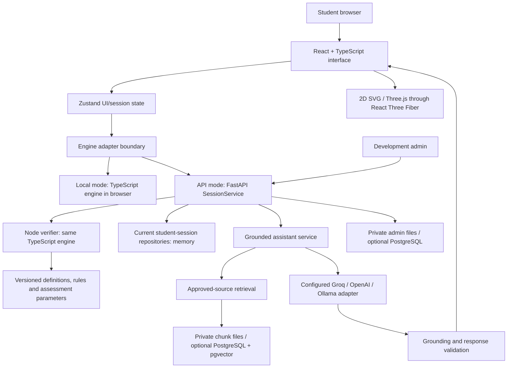

# PP1 presentation and viva guide: Chemistry Studio

Prepared for 22 October 2026, Asia/Colombo. This describes the repository implementation, not a verified production deployment. It does not inspect `.env`, confirm live provider availability, or measure a percentage of research completion.

## 1. Your opening explanation

> My component is an intelligent virtual chemistry laboratory for Sri Lankan G.C.E. A/L students. It combines interactive 2D and 3D laboratory practice, a deterministic chemistry engine, English and Sinhala learning content, and a source-grounded assistance pipeline. Students can prepare, perform a supported practical, record observations and reflect on their work. The chemistry engine controls actions, calculations and procedural consequences. The language model explains retrieved approved material; it does not control the experiment or award competency scores.
>
> At this progress stage, Practical 4 is the most complete end-to-end implementation. The library also has guided workspaces for Practicals 1–30, with documented limits for the additional models. The remaining research work includes teacher validation, broader simulation coverage, reliable bilingual retrieval and feedback, production authentication and persistence, and educational evaluation.

The umbrella project is the **Mastery-Conditioned RAG Tutoring System for Sri Lankan A/L Exam Preparation**. This repository implements its **virtual chemistry laboratory component**. Do not imply it implements every component of the group project.

## 2. Problem, objective and contribution

### Problem addressed

Students need opportunities to practise laboratory procedures, understand mistakes and connect observations with chemistry explanations. Physical practice depends on available apparatus, chemicals, teaching time and supervision. A generic chatbot alone does not enforce a laboratory sequence or guarantee that its explanations match the syllabus.

These are the project's motivations. Do not quote access statistics or claim an experimentally established learning problem without supporting literature or your own study.

### Objective

Provide repeatable, curriculum-linked virtual practice with controlled experiment behaviour, bilingual access, traceable explanations and an inspectable record of learner actions.

### Defensible contribution

The contribution being developed is the integration of a source-linked simulation, learner interaction evidence, adjustable guidance and grounded explanations within the Sri Lankan A/L chemistry context. React, RAG and an LLM are technologies used to build the contribution, not themselves research novelty.

Whether this improves learning or measures mastery accurately must still be established through evaluation. Do not claim it is the first such system or that its effectiveness is proven.

## 3. Student and administrator workflows

### Student workflow

1. Open the practical library and choose an experiment.
2. Read its overview: aims, apparatus, method, precautions, sources and model limits.
3. Answer pre-lab questions and write a prediction, or explicitly choose **Skip pre-lab**. Skipping is not a correct answer and does not remove required safety checks.
4. Complete workbench setup and applicable safety acknowledgements. Practical 4 additionally offers automatic, guided and manual modes; the other models do not yet have equivalent mode coverage.
5. Use the 2D or 3D workbench. Relevant instrument controls open beside/over the instrument when the current step needs configuration or a reading.
6. Perform supported actions in their permitted order. Moving a drawing or changing the viewing mode does not itself perform a chemical action.
7. Record trials and maintain the notebook.
8. Complete reflection and view the report. The report distinguishes measured/entered information, calculated outcomes and learner writing.

The shared additional-practical journey is **Overview → Pre-lab → Setup → Workbench → Notebook → Reflection → Report**. Practical 4 retains its established mode-selection/session flow.

### Administrator workflow

The development admin console supports PDF import, draft extraction and review, knowledge-version management, translation review interfaces, audit records and template-based simulation authoring.

For an additional supported teaching model, an author can enter bilingual text, supported apparatus, ordered actions, appearances, outcome comparisons and source references, preview 2D/3D, save a staged version and attest to local review before enabling local availability. Editing invalidates that availability/review state.

**Boundary:** importing a PDF does not automatically create a scientifically correct simulation. No-code authoring operates within implemented templates and instrument behaviours. A new reaction model, instrument behaviour or arbitrary physics still needs trusted code and validation. The console is development/local administration, not a finished production teacher portal.

## 4. System architecture



### Layer responsibilities

| Layer                   | Responsibility                                                                           | Reason for separation                                                               |
| ----------------------- | ---------------------------------------------------------------------------------------- | ----------------------------------------------------------------------------------- |
| Presentation            | Pages, notebook, controls, translations and 2D/3D views                                  | Graphics can change without changing chemistry rules.                               |
| UI/session state        | Current screen, language, selected apparatus and writing drafts                          | Keeps interaction state separate from scientific calculations.                      |
| Simulation core         | Valid actions, state transitions, quantities, errors, guidance and supported assessment  | Behaviour is deterministic, testable and independent of React.                      |
| API/application service | Validation, session ownership boundary, action sequencing, notebook versions and reports | Provides a server authority boundary for API-backed Practical 4 sessions.           |
| Knowledge/RAG           | Approved evidence retrieval, provider calls, citations, validation and refusals          | Keeps generated explanations separate from experiment authority.                    |
| Storage                 | Sessions/events, admin content and knowledge versions, depending on adapter              | Allows local development and a future durable deployment without changing UI logic. |

### Local mode versus API mode

- **Local:** the engine executes in the browser. It is useful for demonstrations and does not require a backend for simulation. It is not a secure examination environment, because browser-held state can be inspected. The grounded assistant requires the backend.
- **API-backed Practical 4:** the browser submits typed actions. FastAPI validates them and uses a Node CLI to replay/apply the same TypeScript engine. The response contains a public projection rather than unrestricted engine state.
- **Other 29 practicals:** currently bounded local guided models. Having a backend running does not make those local workspaces durable, server-verified Practical 4 equivalents.

### What “deterministic” means

Given the same versioned definition, initial conditions, seed and action sequence, the core reproduces the same outcome. An LLM is not asked to improvise whether an action succeeds.

For API actions, the service checks action IDs and sequence numbers. A duplicate request does not apply the same action twice; stale or conflicting requests are rejected. Replaying the event history supports checking how a result was obtained.

## 5. A concrete chemistry example for the viva

Practical 4 prepares **250 cm³ of 1 mol dm⁻³ Na₂CO₃ solution**.

```text
V = 250 cm³ = 0.250 dm³
n = cV = 1 × 0.250 = 0.25 mol
M(Na₂CO₃) = 106 g mol⁻¹
m = nM = 0.25 × 106 = 26.5 g
```

The learner selects appropriate apparatus, weighs the solid, transfers it, retains washings, dissolves it, makes up to the mark, mixes and labels the solution.

The engine tracks relevant quantities and actions. For example, incomplete transfer can reduce the solute reaching the flask; overshooting changes final volume. Supported calculations use the transferred mass and final volume:

```text
c = (transferred mass / molar mass) / final volume in dm³
```

The model does not assign arbitrary numerical concentration penalties for every mistake. Dirty glassware or tap water can create validity/purity concerns; insufficient mixing can create homogeneity concerns without evidence for a particular numerical concentration change.

**Useful viva line:** “I distinguish a measurement consequence from a technique or validity concern. I do not invent a numerical effect just to produce a score.”

The source procedure and calculations are traced to approved NIE material. Simulation tolerances, scoring weights and other quantities not provided by those sources are documented as provisional simulation assumptions pending teacher review.

## 6. Tools and technologies

| Technology                               | Where and why it is used                                                           |
| ---------------------------------------- | ---------------------------------------------------------------------------------- |
| React                                    | Component-based student and administrator interfaces.                              |
| TypeScript                               | Typed frontend, shared contracts and simulation engine.                            |
| Vite                                     | Development server and production frontend bundling.                               |
| Zustand                                  | UI/session state and learner drafts; not a database.                               |
| SVG                                      | Interactive, schematic 2D apparatus views.                                         |
| Three.js + React Three Fiber             | WebGL-based 3D apparatus, camera and selection interaction.                        |
| i18next / react-i18next                  | English/Sinhala interface and authored-content localisation.                       |
| Noto Sans Sinhala                        | Sinhala-capable font support.                                                      |
| Python + FastAPI                         | HTTP API, session services, administration and assistant orchestration.            |
| Uvicorn                                  | ASGI server running FastAPI.                                                       |
| Zod                                      | TypeScript contract/content validation and exported JSON Schemas.                  |
| Pydantic + jsonschema                    | Typed Python request parsing and validation against shared schemas.                |
| pypdf                                    | Extraction from source PDFs; extraction does not replace human content review.     |
| sentence-transformers / multilingual E5  | Local text embeddings for knowledge retrieval.                                     |
| PostgreSQL / Supabase                    | Database schema target and implemented optional knowledge/admin persistence paths. |
| pgvector                                 | Storage and similarity comparison of knowledge embeddings in PostgreSQL.           |
| psycopg                                  | Python PostgreSQL access.                                                          |
| Vitest / React Testing Library           | Core, contract and frontend tests.                                                 |
| Pytest                                   | API, retrieval, generation-validation and security-boundary tests.                 |
| Playwright                               | Real-browser workflows, layout, keyboard/pointer interactions and viewports.       |
| ESLint, Prettier, Ruff, TypeScript, mypy | Code quality, formatting and static checks.                                        |
| pnpm workspaces / uv                     | JavaScript monorepo and Python dependency/environment management.                  |
| Git                                      | Source/version control.                                                            |
| Docker                                   | Optional disposable PostgreSQL/pgvector migration smoke testing.                   |

The architecture is a modular application with separate frontend/API processes and a shared engine package. It is not necessary to describe every directory as a deployed microservice.

## 7. APIs and their purposes

### Your application's HTTP endpoints

| Endpoint                                                          | Purpose                                                                                                                |
| ----------------------------------------------------------------- | ---------------------------------------------------------------------------------------------------------------------- |
| `GET /health`                                                     | Service health/capability information.                                                                                 |
| `GET /experiments`                                                | List the API's runnable published experiment catalog. This is not identical to the UI's 30-entry local guided library. |
| `GET /experiments/{experiment_id}`                                | Retrieve a published experiment definition.                                                                            |
| `POST /sessions`                                                  | Create an API-backed simulation session with definition/assessment versions and mode.                                  |
| `GET /sessions/{sid}`                                             | Read the permitted public session state.                                                                               |
| `POST /sessions/{sid}/actions`                                    | Submit an action for sequencing, replay and deterministic validation.                                                  |
| `PUT /sessions/{sid}/notebook`                                    | Save an API-backed notebook with version checks.                                                                       |
| `GET /sessions/{sid}/report`                                      | Obtain the supported completed-session report.                                                                         |
| `POST /assistant/ask`                                             | Submit a question for grounded, cited assistance.                                                                      |
| `/admin/dev/imports`, `/drafts`, `/knowledge/*`                   | Development PDF import, draft/review and knowledge management.                                                         |
| `/admin/dev/simulation-models` and activation/deactivation routes | Supported teaching-package authoring and local availability management.                                                |

### External/provider interfaces

| Interface                    | Purpose and current claim                                                                                                                                       |
| ---------------------------- | --------------------------------------------------------------------------------------------------------------------------------------------------------------- |
| Groq API adapter             | Configurable language generation provider. It does not calculate the laboratory result.                                                                         |
| OpenAI Responses API adapter | Configurable generation provider or technical fallback, depending on selected routing.                                                                          |
| Ollama interface             | Optional local-model provider; also available for supported local extraction assistance.                                                                        |
| Supabase Auth/JWT            | Planned production identity integration. The current principal implementation is a development/test identity; the JWT provider is a failing-closed placeholder. |

The configured model/provider is selected server-side. Do not state that every question calls multiple providers. Technical failover is for faults such as rate limits/timeouts, not for repeatedly asking different models until one gives a favourable answer. Live configuration and provider quality are separate from having an adapter implemented.

## 8. Databases and storage: precise current status

| Data                                                           | Current implementation                               | Future/optional database role                                                                                                                             |
| -------------------------------------------------------------- | ---------------------------------------------------- | --------------------------------------------------------------------------------------------------------------------------------------------------------- |
| Additional guided practical runs, pre-lab/reflection drafts    | Current browser tab state; refresh clears local work | Durable learner/attempt storage remains future work.                                                                                                      |
| Practical 4 API sessions, action events, notebooks and reports | In-memory repositories; API restart loses them       | Relational tables/migrations exist, but the PostgreSQL student-session adapter is not enabled/implemented. Setting `LAB_REPOSITORY=postgres` is rejected. |
| Admin drafts, authored packages and audit records              | Private local files by default                       | Implemented optional PostgreSQL admin repository.                                                                                                         |
| Approved knowledge chunks and embeddings                       | Private versioned files loaded into memory           | Implemented optional PostgreSQL/pgvector knowledge repository.                                                                                            |
| Answer cache                                                   | In-process cache                                     | Shared/durable caching is a future scaling consideration.                                                                                                 |

The migrations define `experiments`, `sessions`, `action_events`, `notebooks`, `reports`, `knowledge_versions`, `knowledge_chunks`, versioned catalog tables and admin/audit records.

- **Relational columns** represent identities, ownership, versions and sequence relationships.
- **JSONB** holds structured definitions, notebook documents, event payloads and report records whose fields vary by model/version.
- **pgvector embeddings** support semantic evidence retrieval. The recorded E5 model uses **384 dimensions**. The current small-corpus retrieval uses exact similarity search; do not claim a deployed approximate-nearest-neighbour index without verifying it.
- **RLS policies** are defined for a future authenticated database deployment. They do not provide authentication to the current in-memory development API.

**Viva answer:** “Supabase provides a PostgreSQL-based platform; pgvector is an extension for embeddings in that database, not a second independent database. We have storage schemas and optional knowledge/admin adapters, while durable student-session integration and real authentication remain unfinished.”

## 9. How the grounded assistant works

### Knowledge preparation

1. Select approved NIE handbook, resource-book and syllabus pages.
2. Extract and normalise text.
3. Split text into section/page-aware chunks.
4. Retain source title, edition, page, language and checksum metadata.
5. Produce passage embeddings using the configured multilingual embedding model.
6. Store a versioned private knowledge collection and an active-version reference.

The bundled manifest records a Practical 4 baseline: 13 chunks, 12 in scope, from 9 approved pages. The UI's 30 practicals do not automatically mean 30 equally reviewed RAG knowledge collections.

### Answering a question

```text
Question → language selection → ownership/safe-context checks → injection screening
→ cache lookup → semantic/heading retrieval → selected evidence passages
→ configured generator → response/grounding validation → cited answer or refusal
```

The retrieval pipeline admits at most eight candidates and passes at most four evidence chunks to generation. It combines heading matching with embedding similarity.

The generation request carries the question, permitted experiment context and retrieved evidence. It does not give the model authority to edit experiment state or scoring. The validation layer checks structured output, citations, supporting spans and supported numerical/formula/entity content. This reduces identifiable unsupported claims but is not a mathematical guarantee against all hallucination or irrelevant answers.

The response carries source/page citations. Insufficient evidence should result in refusal rather than an invented chemistry explanation. Current support outside Practical 4 is primarily local source-linked procedure/help; do not claim a fully expanded grounded assistant for every guided model.

**RAG is not fine-tuning.** The system retrieves source passages at request time; it has not trained a new foundation language model on the NIE handbook.

### Bilingual handling

The interface language and the submitted text's language are separate. Sinhala script detection selects Sinhala assistance/feedback even under an English UI; an English question can select English under a Sinhala UI. Chemical notation and units can remain mixed with either language.

Written-answer comparisons normalise equivalent Unicode notation while preserving original learner writing. Supported source-guide rules check some calculations/concepts in both languages. Unrecognised explanations and questions without authored checking rules require teacher review. This is not universal automatic Sinhala essay marking.

Sinhala authored content and translations still require qualified teacher review. Reliable language selection is different from proven bilingual scientific accuracy.

## 10. Completed work and limitations

| Area                   | What can be demonstrated now                                                                              | What must not be overstated                                                                                               |
| ---------------------- | --------------------------------------------------------------------------------------------------------- | ------------------------------------------------------------------------------------------------------------------------- |
| Practical library      | 30 practical entries with learner flows and supported 2D/3D workspaces                                    | Not 30 equally complete predictive physics models.                                                                        |
| Practical 4            | Fullest versioned engine, calculations, modes, errors, guidance, notebook and supported competency report | Scientific assumptions and score weights still need teacher validation.                                                   |
| Other 29 practicals    | Guided procedures, apparatus, bounded calculations/observations, trial recording and reports              | Full manual/automatic parity and broad scientific branch coverage remain incomplete.                                      |
| Simulation interface   | Movable apparatus, instrument setup dialogs, notebook rail, 2D/3D views and responsive flows              | Rendered apparatus/fill levels are schematic, not calibrated photorealistic measurements.                                 |
| Preparation/reflection | Optional pre-lab, required applicable safety, retained current-tab writing and reports                    | Skipped/unanswered questions are not awarded correctness.                                                                 |
| Bilingual checks       | Language-aware input/feedback and five bounded Practical 4 source-guide checks                            | Not universal free-text grading.                                                                                          |
| Assistant              | Backend retrieval/generation adapters, citations, guardrails, caching and tests                           | Availability depends on configured backend/knowledge/provider; live learning quality is not established by adapter tests. |
| Admin authoring        | Supported template authoring, preview, staged storage, local activation and review invalidation           | Arbitrary apparatus/chemistry and production publishing are not no-code.                                                  |
| Storage/security       | Schemas, repository boundaries, optional knowledge/admin PostgreSQL and ownership checks                  | No completed production login or durable student-session deployment.                                                      |
| Adaptation             | Rule-based guidance recommendations from interaction evidence                                             | No trained or validated mastery-prediction model.                                                                         |

Special data limits: Practicals 7/8 may use explicitly labelled synthetic practice datasets pending review. Practical 30 uses learner-entered timings and a `1/time` comparison proxy, not a claimed absolute rate constant.

### Testing evidence

Documented recent runs include 231 core tests, 383 frontend tests, 53 focused assistant/language API checks, and 10 latest browser checks. Earlier broader browser runs exercised all 30 practicals across desktop/tablet/mobile and admin authoring. These are separate runs with overlapping coverage; do not add them together as one fresh unique test total. Some Practical 4 browser tests intentionally run only on desktop.

Automated tests support software behaviour. They do not establish pedagogical effectiveness, teacher approval, real-device accessibility or mastery validity. This guide preparation did not rerun the suites.

### Recorded research baseline

`docs/RAG_EVALUATION.md` records an earlier small-corpus retrieval run with 16 English and 16 Sinhala supported questions. Recall@4 was 0.979 for English and 0.729 for Sinhala-to-English retrieval. These are retrieval metrics, not answer accuracy or student marks. The Sinhala translations were unreviewed, and the run predates later code changes; treat it as a historical baseline, not the current deployed performance.

## 11. Future development and research evaluation

Prioritise the remaining work as milestones rather than promising every feature simultaneously:

1. **Scientific/content validation:** teacher-review procedures, provisional parameters, outcomes, Sinhala terminology and answer rubrics; resolve source conflicts.
2. **Depth of simulation coverage:** extend the additional models' supported branches and quantitative consequences; add instrument behaviour through trusted, tested engine extensions.
3. **Reliable bilingual feedback:** author broader English/Sinhala checking rubrics; evaluate paraphrases, mixed notation, negation and unfamiliar answers; keep an explicit review/abstention path.
4. **Broader grounded knowledge:** build and review per-practical knowledge versions; improve Sinhala retrieval and evaluate generated explanations with qualified reviewers.
5. **Production foundation:** real login, student/teacher/admin roles, verified JWTs, durable PostgreSQL student-session repositories, tested access rules and secure deployment.
6. **Mastery/adaptation research:** define competencies and labels with teachers; collect consented interaction data; compare the rule-based baseline with a justified learner model. Select methods such as knowledge tracing only after the task/data support them.
7. **Educational evaluation:** run an approved pilot comparing relevant learning outcomes, such as procedural-error reduction, pre/post performance and transfer to supervised practical work.
8. **Usability/performance:** keyboard/touch/assistive-technology evaluation on real devices, low-bandwidth behaviour, bundle optimisation, verifier overhead and concurrent-session load.

Suggested measures: teacher-rated content correctness and feedback usefulness; English/Sinhala retrieval Recall@k and MRR; citation correctness, unsupported-claim/refusal behaviour, latency and cost; task completion and usability; learning outcomes with an appropriate study design.

A pre/post improvement alone is not proof that the system caused the change. Use a justified comparison, consent process, sample and analysis plan. Do not promise a model's accuracy before training/evaluation.

## 12. Suggested 10-slide PP1 structure

| Slide | Focus                     | What to say/show                                                                                        |
| ----- | ------------------------- | ------------------------------------------------------------------------------------------------------- |
| 1     | Title and component scope | Identify the laboratory component within the group research.                                            |
| 2     | Problem and objectives    | Explain why repeated procedural practice and syllabus-grounded feedback matter.                         |
| 3     | Research contribution     | Show the intended link between simulation evidence, guidance and grounded help.                         |
| 4     | Architecture              | Use the diagram; distinguish engine authority from generated explanation.                               |
| 5     | Learner flow              | Library → preparation/setup → workbench → notebook/reflection/report.                                   |
| 6     | Technologies and storage  | Explain each major tool's role and disclose current memory versus database boundaries.                  |
| 7     | Practical 4 demonstration | Show one correct calculation/action and one rejected or consequential mistake.                          |
| 8     | Bilingual/RAG pipeline    | Show input-language handling, a source citation and an unsupported-answer/refusal case.                 |
| 9     | Progress and evidence     | Separate the full Practical 4 engine from the 29 bounded guided models; show documented tests/baseline. |
| 10    | Remaining work            | Teacher review, durable/authenticated deployment, broader modelling and research evaluation.            |

For a short presentation, put detailed API tables and extended viva questions in backup slides. PP1's “50%” is a review milestone, not a percentage inferred from source files or feature counts.

## 13. A practical five-minute demonstration

1. Show the library and one overview, then clearly identify Practical 4 as the main validation case.
2. Demonstrate English/Sinhala switching and the explicit optional pre-lab path; complete required safety before guided work.
3. Show the same bench in 2D and 3D. Explain that visual changes do not change the experiment result.
4. Demonstrate a correctly ordered action and one rejected action or supported measurement error.
5. Show a relevant instrument setting popup and the notebook's single-row section navigation.
6. Show a completed report and explain the evidence behind a calculation or technique concern.
7. If the assistant backend is available, ask a rehearsed source-supported question and display its citation. Keep a labelled screenshot as backup if live services fail; do not present the backup as a live response.
8. Briefly show supported admin authoring/preview only if time permits.

Use a known working run before the presentation. Avoid last-minute dependency/model/configuration changes. Never expose `.env`, credentials or student identifiers on the projector.

## 14. Likely viva questions and concise answers

**What is the AI doing?**

It generates explanations from retrieved approved evidence. It does not decide the physical outcome or competency score. Guidance also includes implemented deterministic rules.

**Where is mastery conditioning implemented?**

The present laboratory has interaction evidence and rule-based guidance recommendations. A trained and validated mastery-conditioned learner model is future research, not a completed claim.

**Why not let the LLM simulate chemistry?**

Generated outputs can vary and contain unsupported facts. The deterministic engine makes permitted actions and outcomes reproducible and testable; the LLM remains explanatory.

**How does the system know the result is correct?**

Supported calculations and transition rules come from versioned source-linked content and tests. That establishes implementation consistency, while teacher review and empirical validation are still needed for scientific/model adequacy.

**Are all 30 practicals fully simulated?**

All 30 have supported learner workspaces. Practical 4 has the most complete engine/mode/assessment implementation. The other 29 are bounded guided models with explicit exclusions.

**Can students skip pre-lab?**

Yes, explicitly. Partial answers remain available and unanswered fields are not marked correct. Required setup/safety checks remain.

**Can the system mark every Sinhala answer correctly?**

No such universal claim is made. It accepts Sinhala and English, selects feedback language from the answer, and performs authored source-guide checks for supported cases. Uncertain or unsupported explanations require review.

**Why RAG instead of only prompting an LLM?**

RAG supplies relevant approved passages and source provenance for each request. It makes evidence selection inspectable and reduces reliance on the model's untraceable recollection, although validation cannot eliminate every error.

**Why an embedding model and an LLM?**

The embedding model maps questions/passages to vectors for retrieval. The generator uses selected evidence to produce an explanation. They solve different tasks.

**Did you train the model?**

No new foundation model was trained. The implementation uses pretrained embeddings and configurable generation providers; preparing a knowledge base is not model training.

**Why PostgreSQL and pgvector?**

They support structured/versioned records and vector evidence retrieval within one database platform. Current student sessions are still in memory; knowledge/admin PostgreSQL adapters are optional implemented paths.

**How do you prevent duplicate actions and tampering?**

API-backed actions use IDs, expected sequence numbers and replay through the trusted engine. The server derives the public result rather than trusting a submitted score. Local browser mode does not offer the same trust boundary, and production identity is unfinished.

**Can the system replace a real laboratory?**

It is intended to support preparation and repeated practice. Real handling skills, equipment calibration and supervised safety competence still require physical laboratory work and teacher assessment.

**How will you evaluate the research?**

Separate software correctness, scientific validity, bilingual/RAG quality and educational effectiveness. Use engine/regression tests, teacher review, held-out bilingual evaluations and an approved learner study respectively.

**What remains for the next milestone?**

Teacher-reviewed content and rubrics, deeper models, durable authenticated learner storage, broader bilingual evidence coverage, and a study that can test whether the proposed support improves learning.

## 15. Repository evidence to cite

- [Current progress and recorded checks](STATUS.md)
- [Architecture and action verification](ARCHITECTURE.md)
- [Chemistry source map and limits](SOURCE_MAP.md)
- [Historical retrieval evaluation](RAG_EVALUATION.md)
- [API routes and current session-repository wiring](../apps/api/app/main.py)
- [Authentication boundary](../apps/api/app/principal.py)
- [Configuration capabilities and guards](../apps/api/app/settings.py)
- [Knowledge repository selection](../apps/api/app/knowledge_runtime.py)
- [Engine and action handling](../packages/simulation-core/src/engine.ts)
- [Rule-based guidance](../packages/simulation-core/src/guidance.ts)
- [Written-answer checking limits](../packages/simulation-core/src/writtenAnswers.ts)
- [Versioned Practical 4 content](../content/experiments/exp04/definition.v1.json)
- [Knowledge manifest](../content/knowledge/manifest.v1.json)
- [Database migrations](../supabase/migrations)

Some older README/demo/status sections describe earlier milestones and can contradict later work. Prefer current implementation and the newest dated status entries. Do not repeat an old “no live calls ever” statement or treat a provider connectivity check as a formal quality evaluation.
